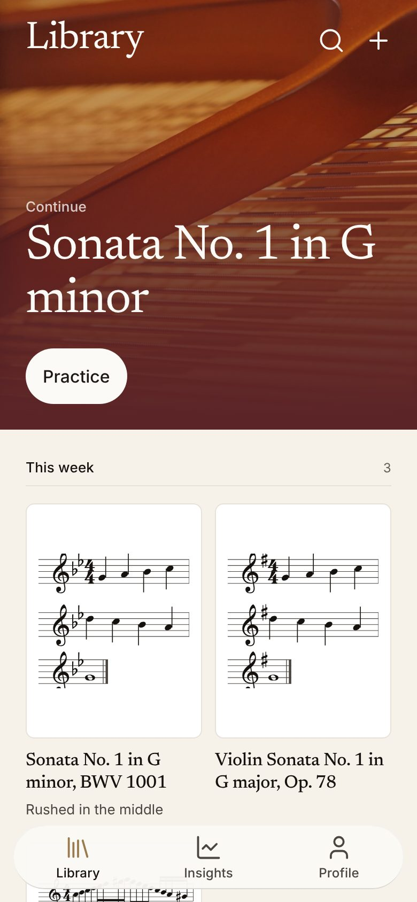
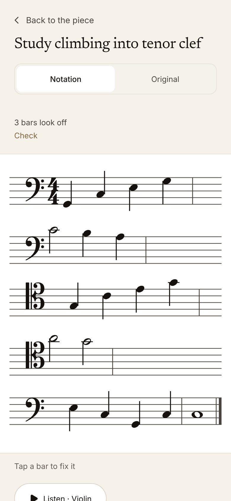
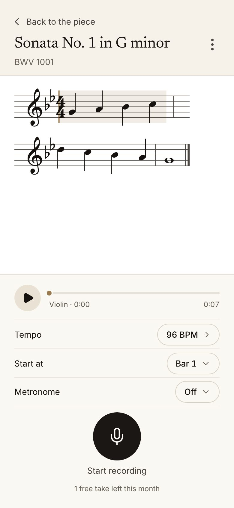
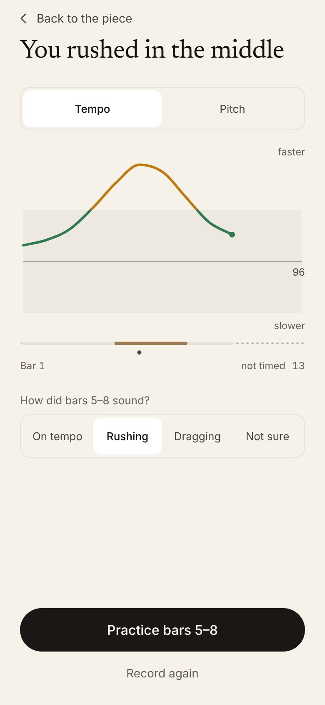
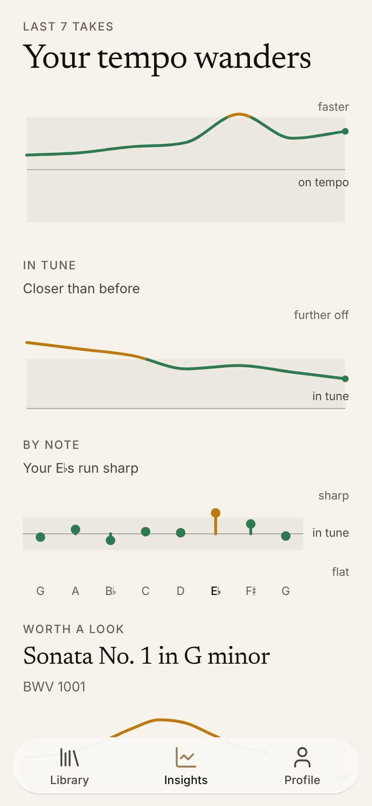
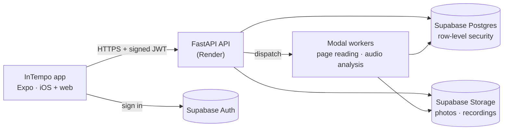

<!--
  Before submitting: add the demo video link and the live web app link here.
  Demo video: https://…
  Live app:   https://idk-41z.pages.dev
-->

<h1 align="center">InTempo</h1>

<p align="center">
  <strong>A practice partner that reads your sheet music, listens to you play it,<br>
  and tells you exactly where you rushed or dragged, bar by bar.</strong>
</p>

<p align="center">
  <a href="https://idk-41z.pages.dev"><strong>Open the live app →</strong></a>
</p>

<p align="center">
  
  
  
  
  
  
</p>

<p align="center">
  
  
  
  
  
</p>

---

## The problem

Most music practice happens alone. A student sees their teacher once a week and
spends the other six days practising with nobody listening, and timing is the
habit that drifts most quietly in that time. A metronome tells you where the
beat *is*. It can't tell you that you rushed bars 5 to 8 three days in a row,
that you drag every time the passage climbs, or that your E-flats run sharp.
By the next lesson the habit is a week deeper.

## What InTempo does

1. **Bring in your part.** Photograph the pages with your phone, choose photos
   you already have, or import a MusicXML file from notation software. InTempo
   reads the page into real notation: notes, rests, ties, repeats, key and
   time signatures, clefs and tempo markings. It shows you the bars it isn't
   sure of so you can fix them with a tap.
2. **Hear it first.** *Listen* plays your part back with sampled violin, viola,
   cello, double bass, alto or tenor saxophone, at your tempo, from any bar.
3. **Record a take.** Pick a tempo, a start bar and a metronome you can see,
   feel (haptics) or hear (through headphones), and play. A long rest can be
   shortened while you practise the notes around it.
4. **See exactly what happened.** InTempo lines up every note you played with
   the note on the page. It tells you which bars rushed or dragged and by how
   much, how in tune you were against *your own* tuning, and which notes were
   wrong or rests miscounted. Then it offers to practise just those bars.
5. **Watch it change.** Insights tracks tempo and intonation across takes, so
   you can see a habit fading, or not.

The whole app also runs in a phone's browser. A musician without an iPhone, or
without an App Store account, still has the full tool.

## How it works



**Reading a page.** A photograph goes to [homr](https://github.com/liebharc/homr),
an open-source optical music recognition engine running on a serverless worker.
Its output is imported as MusicXML and checked by arithmetic: every bar's
durations must add up to what the time signature allows. That check needs no
second model and no ground truth, so it runs on every page. Claude is asked to
re-read **only the bars that fail it**, and its answer is kept only if it leaves
fewer broken bars than it found. The language model can repair a reading but
never originates one. Claude also reads tempo words ("poco rit.", "a tempo",
"♩ = 88") and dynamics off the photograph.

**Judging a take** (`backend/app/services/`):

| Stage | Module | What it does |
|---|---|---|
| Onsets | `audio.py`, `onset_recovery.py` | Finds every note attack with spectral-flux onset detection, then takes a second, stricter look for quiet notes a live room swallows |
| Alignment | `alignment.py` | Builds the expected timeline from the score (repeats, ties, tempo changes, skipped rests), then warps the take onto it with dynamic time warping and repairs missed or extra notes |
| Classification | `classification.py` | Per-note early/late in milliseconds, per-bar tempo, a rolling trend, and one plain-English verdict |
| Pitch | `intonation.py`, `pitch_evidence.py`, `player_mistakes.py` | Intonation in cents against the player's own tuning, wrong notes and miscounted rests, and a check that the take is this piece at all |

If the alignment is too poor to trust, the analysis says so ("check you're on
the right piece") instead of producing confident numbers about the wrong music.

| Layer | Technology |
|---|---|
| App | Expo SDK 57, React Native 0.86, react-native-web, TypeScript, TanStack Query, React Navigation 7 |
| Audio in the app | Web Audio + AudioWorklet (web), expo-audio (native), SoundFont playback |
| API | FastAPI on Python 3.12, managed with uv |
| Signal processing | librosa, NumPy, SciPy |
| Page reading | homr (on Modal), MusicXML import, Claude for repairs and tempo words |
| Data | Supabase: Postgres with row-level security, Auth, Storage |
| Hosting | Cloudflare Pages (web app), Render (API), Modal (page reading and analysis), sized to fit free plans |

## What sets it apart

- **It is honest about what it doesn't know.** A bar the reader is unsure of is
  flagged for the musician to check, not silently guessed. A bar under a
  *rit.* is not judged against the steady tempo. A take that doesn't match the
  page is refused rather than graded. A slow server says it's slow; a refused
  scan blames the server, not the photograph.
- **It respects how musicians practise.** Start from any bar, shorten a long
  rest, practise the four bars it flagged, play at a printed dotted-quarter
  tempo in 6/8. Intonation is judged against the instrument as *you* tuned it,
  so a violin tuned slightly high isn't marked sharp on every note.
- **It doesn't lose a performance.** A take recorded with no signal is kept on
  the device and sent automatically when the connection returns, under the
  account that recorded it, without ever being analysed (and charged) twice.
- **Privacy is built in, not bolted on.** Every table is protected by row-level
  security. Recordings and photos are private and reached only through
  short-lived signed links. Deleting an account removes every recording,
  photograph and derivative it owns, and the full data export is one tap.
- **Accessibility is enforced by the build.** An automated audit checks every
  screen in light *and* dark mode for 44-point touch targets, 4.5:1 contrast,
  screen-reader names and 200% text, and fails the build otherwise. Motion
  respects Reduce Motion.
- **Defended against hostile input.** Uploaded audio is identified by its bytes,
  not its file name, and capped by duration before any decoder sees it. MusicXML
  is parsed with entity expansion disabled and bounded so a tiny file can't
  exhaust memory. Every place the server fetches a URL is inventoried against
  SSRF in CI.

## Quality, by the numbers

| | |
|---|---|
| Automated tests | **5,837**: 2,966 backend (pytest) and 2,871 app (vitest) |
| Database migrations | 30, every one replayed in order against an empty Postgres on every push |
| CI gates | brand assets, dead exports, dependency advisories, outbound-fetch inventory, migrations, lint, typecheck, font coverage, web and iOS bundle builds, bundle-size budget, a scripted walk through the real web app, fake-device camera and microphone checks, and the accessibility audit |
| Codebase | ~31k lines of Python and ~72k lines of TypeScript, with ~89k lines of tests |

Every gate CI runs can be run locally with one command (`tools/preflight.py`).

## Try it

**Prerequisites:** Node 22+, Python 3.12+ with [uv](https://docs.astral.sh/uv/).
No accounts or API keys are needed for the first two.

**1. The app, on sample data (2 minutes).**

```bash
cd mobile
npm install
npm run web          # opens in the browser; `npm start` then `i` for the iOS simulator
```

With no backend configured, the app runs on a deterministic sample library
(public-domain repertoire) and says so at boot. Every screen works.

**2. The analysis engine, on a recording, with no network.**

```bash
cd backend
uv sync
uv run python -m tuning_dashboard.cli ../fixtures/audio/02_detache_rushing.synthetic.wav
```

```
02_detache_rushing.synthetic.wav   60 BPM   double bass

Bars 2–8 ran ahead.

status ok   quality 0.999
heard 32 onsets against 32 written   missed 0   extra 0

  bar  notes   drift            ahead | behind
    1      4    -1.2%           =|
*   2      4    -4.4%          ==|
*   3      4    -7.6%        ====|
*   4      4   -10.8%       =====|
...
```

`uv run uvicorn tuning_dashboard.app:app --port 8100` opens the same analysis
as a waveform with every detected onset marked.

**3. The API.**

```bash
cd backend
cp .env.example .env    # fill in a Supabase project to go beyond health checks
uv run uvicorn app.main:app --reload
```

`GET /v1/health` answers at once. `GET /v1/ready` lists exactly what is still
unconfigured and what each missing piece costs a musician.

**4. The full stack.** Create a Supabase project and apply
`backend/app/migrations/` in order, then follow
[`docs/deploy-backend.md`](docs/deploy-backend.md) (API),
[`docs/deploy-modal.md`](docs/deploy-modal.md) (page reader and analysis
workers) and [`docs/deploy-cloudflare-mobile.md`](docs/deploy-cloudflare-mobile.md)
(web app). Setting `EXPO_PUBLIC_SUPABASE_URL`, `EXPO_PUBLIC_SUPABASE_ANON_KEY`
and `EXPO_PUBLIC_API_BASE_URL` switches the app from sample data to real
accounts.

**Run the checks.**

```bash
python3 tools/preflight.py          # lint, typecheck, unit tests, audits
python3 tools/preflight.py --full   # plus the web and iOS builds, the app walk and the accessibility audit
```

## Repository map

```
intempo/
├── mobile/                  the app: Expo / React Native for iOS, built to the web too
│   └── src/
│       ├── screens/         one folder per screen (library, scanner, record, verdict, insights …)
│       ├── components/      primitives, engraved notation, charts, sheets
│       ├── data/            API client, auth, sample-data/API seam, cached queries
│       ├── lib/             audio capture, metronome, score playback, offline take queue
│       ├── navigation/      routes, deep links, the tab bar
│       └── design/          design tokens: the only place a colour or size is defined
├── backend/                 FastAPI service
│   ├── app/
│   │   ├── routers/         HTTP endpoints (/v1/scores, /v1/analyses, /v1/me …)
│   │   ├── services/        signal processing, alignment, intonation, OCR pipeline
│   │   ├── workers/         background page reading and analysis, with crash recovery
│   │   ├── migrations/      the Postgres schema, 001–030
│   │   └── tests/           pytest suite
│   ├── tuning_dashboard/    offline analysis CLI and waveform viewer
│   └── modal_app.py         the serverless worker images
├── fixtures/                public-domain scores, audio clips and contracts both sides test against
├── tools/                   CI gates, preflight, benches (see tools/README.md)
├── docs/                    deployment guides, release checklist, subsystem notes
└── redesign/                the HTML design prototypes the screens were built from
```

`DECISIONS.md` records each architectural choice with the alternatives
considered; `TUNING_LOG.md` records every change to an audio threshold with
its regression results; `docs/subsystems.md` collects what was learned the hard
way about each part of the system.

## Status

Deployed: the web app on Cloudflare Pages and the API on Render, with page
reading on Modal. The iOS build is configured and its bundle builds in CI, but
it hasn't been submitted to the App Store yet; `python3 tools/check-store-readiness.py`
lists what remains. The audio thresholds are tuned against a synthetic corpus,
and tuning against more real recordings is ongoing (`TUNING_LOG.md`). The API
for teachers (studios, assignments, students' takes) is built; its screens are
next.

## Credits

Score fixtures are public-domain editions (`fixtures/scores/SOURCES.md`).
Instrument sounds come from VS Chamber Orchestra 2 Community Edition (CC0) and
GeneralUser GS 2.0.3 (`mobile/assets/soundfonts/NOTICE.md`). Notation is set in
Bravura and Noto Music, text in Newsreader and Inter (SIL OFL). Page reading
uses [homr](https://github.com/liebharc/homr) (AGPL-3.0), unmodified, in its own
container.

## License

MIT, see [LICENSE](LICENSE).
